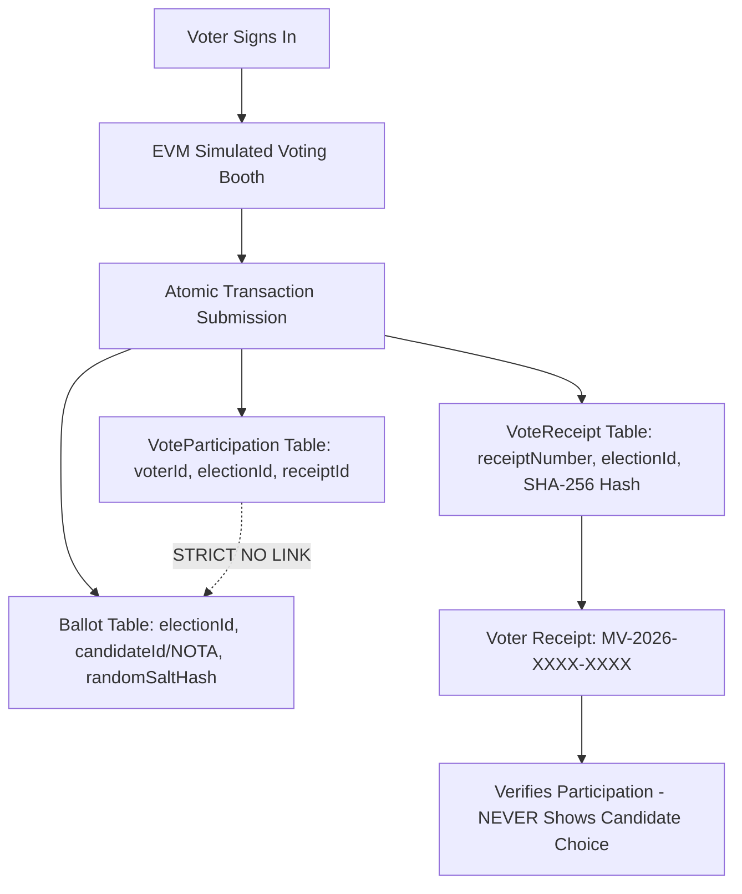

# MahaVote — Maharashtra Election Management Portal (Demo)

> **IMPORTANT DISCLAIMER**:  
> **Educational Demonstration Platform — Not an Official Election Service.**  
> This software is an independent educational and technical demonstration portal inspired by the clean layout, information architecture, and accessibility of the Election Commission of India's EVM Management System ([eci.gov.in/evm-management-system](https://www.eci.gov.in/evm-management-system)).  
> It does not copy official government branding or logos, does not claim to represent official election commissions, does not collect real Aadhaar/EPIC documents or biometrics, and does not hold legal electoral validity.

---

## 🏛️ Project Architecture & Features

MahaVote demonstrates a modern, secure, and privacy-preserving election management system for the State of Maharashtra across legislative, parliamentary, municipal, and panchayat tiers.

### 1. Key Highlights
- **Layout & Design**: Modern Indian public-service portal aesthetic with deep Navy Blue (`#0a2540`), crisp white/slate cards, saffron (`#ea580c`), and green (`#16a34a`) accents.
- **Multilingual Support**: Real-time language switching between **English**, **मराठी (Marathi)**, and **हिंदी (Hindi)**.
- **Accessibility**: Font size scaler (`A-`, `A`, `A+`) and Dark/Light mode toggle.
- **Role-Based Portals (RBAC)**:
  - **Voter Portal**: Electoral roll status lookup, simulated EVM ballot booth, privacy-preserving PDF receipts.
  - **Candidate Portal**: Digital nomination filing, manifesto & asset declarations, live nomination scrutiny tracking.
  - **Election Administration Portal**: Role-specific dashboards for Super Admin, State Election Commissioner, District Election Officer (DEO), Returning Officer (RO), and Auditors.
- **Ballot Secrecy & Zero-Knowledge Architecture**: Strict database separation between voter participation records and anonymous ballots. Receipts verify valid submission without exposing candidate choice.
- **Development OTP Simulator**: Live in-browser SMS/Email simulator modal for seamless testing without telecom gateways.
- **Interactive Visualizations**: Recharts-powered turnout monitoring and candidate vote share distributions.

---

## 🛠️ Technology Stack

| Layer | Technologies |
|---|---|
| **Frontend** | React 19, TypeScript, Vite, Tailwind CSS v4, Lucide Icons, Recharts, jsPDF, Canvas Confetti |
| **Backend** | Node.js, Express.js, TypeScript, Zod, Helmet, CORS, Cookie-Parser, Rate-Limiting |
| **Database & ORM** | Prisma ORM with SQLite (out-of-the-box local dev) and PostgreSQL (Docker/Production) |
| **Authentication** | JWT with refresh-token rotation, bcryptjs password hashing, OTP challenge lifecycle |
| **API Documentation** | Swagger / OpenAPI 3.0 UI at `/api/docs` |
| **Testing** | Vitest with Supertest integration test suite |
| **Containers** | Docker & Docker Compose (`docker-compose.yml`) |

---

## 👥 Demo Pre-Seeded Accounts

All demo accounts are pre-seeded in the database for instant testing:

| Role | Name & Designation | Email / Identifier | Password | Key Permissions |
|---|---|---|---|---|
| **Super Admin** | Shri Rajesh Deshmukh, IAS | `admin@mahavote.gov.in` | `Admin@12345` | Full statewide oversight, audit export, role control |
| **State Admin** | Smt. Vandana Suryavanshi (SEC) | `state.admin@mahavote.gov.in` | `StateAdmin@12345` | Schedule state elections, declare public results |
| **DEO (Pune)** | Dr. Suhas Diwase (Collector) | `deo.pune@mahavote.gov.in` | `DeoPune@12345` | District turnout monitoring, polling oversight |
| **RO (Kasba)** | Shri Milind Mohite (RO) | `ro.kasba@mahavote.gov.in` | `RoKasba@12345` | Review & approve/reject candidate nominations |
| **Auditor** | Smt. Neha Gaikwad | `auditor@mahavote.gov.in` | `Auditor@12345` | Read-only scrutiny of tamper-evident audit logs |
| **Voter 1** | Aarav Suresh Kulkarni | `9876543210` / `voter1@mahavote.demo` | `Voter@12345` | Cast simulated ballot in 215 - Kasba Peth AC |
| **Voter 2** | Tanvi Mahesh Joshi | `9876543211` / `voter2@mahavote.demo` | `Voter@12345` | Cast simulated ballot in 214 - Shivajinagar AC |
| **Candidate 1** | Ananya Deshmukh (Independent) | `ananya@candidate.demo` | `Candidate@12345` | Manifesto: Urban forestry, Symbol: Tree |
| **Candidate 2** | Rahul Patil (Independent) | `rahul@candidate.demo` | `Candidate@12345` | Manifesto: Education reform, Symbol: Book |
| **Candidate 3** | Sneha Jadhav (Independent) | `sneha@candidate.demo` | `Candidate@12345` | Manifesto: Women safety, Symbol: Lamp |

> 💡 **Quick Tip**: You can also use the **"Demo Switcher"** button in the top navigation bar to switch between any of these test roles in 1 click!

---

## 🚀 Quick Start (Local Development)

### Prerequisites
- Node.js v18+ (tested on Node v20/v24)
- npm v9+

### 1. Database Setup & Backend Initialization
```bash
# Navigate to server directory
cd server

# Install dependencies (already installed)
npm install

# Push database schema to SQLite (dev.db)
npx prisma db push

# Seed the database with Maharashtra sample elections, candidates, and voters
npx tsx prisma/seed.ts

# Start the Express API server
npm run dev
```
The backend will start at `http://localhost:5000`.
- 🩺 Health Check: [http://localhost:5000/api/health](http://localhost:5000/api/health)
- 📖 Swagger API Docs: [http://localhost:5000/api/docs](http://localhost:5000/api/docs)

### 2. Frontend Client Initialization
Open a second terminal window:
```bash
# Navigate to client directory
cd client

# Install dependencies (already installed)
npm install

# Start the Vite development server
npm run dev
```
The frontend application will start at `http://localhost:5173`.

---

## 🧪 Running Automated Tests

Run the Vitest integration suite covering authentication, rate limiting, ballot deposition, duplicate vote prevention, and receipt verification:

```bash
cd server
npm test
```

Sample output:
```
✓ tests/api.test.ts (8 tests)
  ✓ GET /api/health should return HEALTHY status
  ✓ POST /api/auth/login should authenticate demo voter
  ✓ POST /api/auth/login should reject incorrect password
  ✓ POST /api/auth/otp/request should generate demo OTP challenge
  ✓ GET /api/elections should list demo elections
  ✓ GET /api/ballot/election/:id should retrieve ballot for eligible voter
  ✓ POST /api/ballot/vote should cast privacy-preserving vote and return receipt
  ✓ POST /api/ballot/vote should block duplicate vote attempt with 409
```

---

## 🔒 Ballot Secrecy & Privacy Architecture

The system implements the **Zero-Knowledge Principle of Electronic Voting**:



1. **Participation Tracking**: `VoteParticipation` ensures single-vote enforcement via `@@unique([voterId, electionId])`.
2. **Anonymous Ballot Box**: `Ballot` stores only the election ID and choice with a cryptographically secure random salt token. There is **no foreign key** or link back to `voterId`.
3. **Receipt Generation**: The receipt contains a unique transaction ID (`MV-2026-XXXX-XXXX`) and timestamp. Candidate choice is omitted by design.

---

## 📱 Development OTP Simulator Guide

When testing voter authentication without carrier SMS credentials:
1. On the login page, select **Voter** -> **Demo OTP Mode**.
2. Enter any 10-digit demo number (e.g., `9876543210`) and click **Send Demo OTP**.
3. Click the orange **OTP Simulator** button in the top navigation bar or next to the OTP input field.
4. The simulator modal will display the generated code (valid for 5 minutes). Click **Use Code** to auto-fill and submit!

---

## 🐳 Docker Deployment (PostgreSQL + Express + React)

For production deployment with PostgreSQL:
```bash
# Start PostgreSQL, Backend, and Frontend containers
docker compose up --build -d
```
Services exposed:
- Web Portal: `http://localhost:5173`
- Backend API: `http://localhost:5000`
- PostgreSQL: `localhost:5432`

---

## 📄 License
Educational Open Source Project. All materials are for technical demonstration and study purposes only.
# online-voting-system

